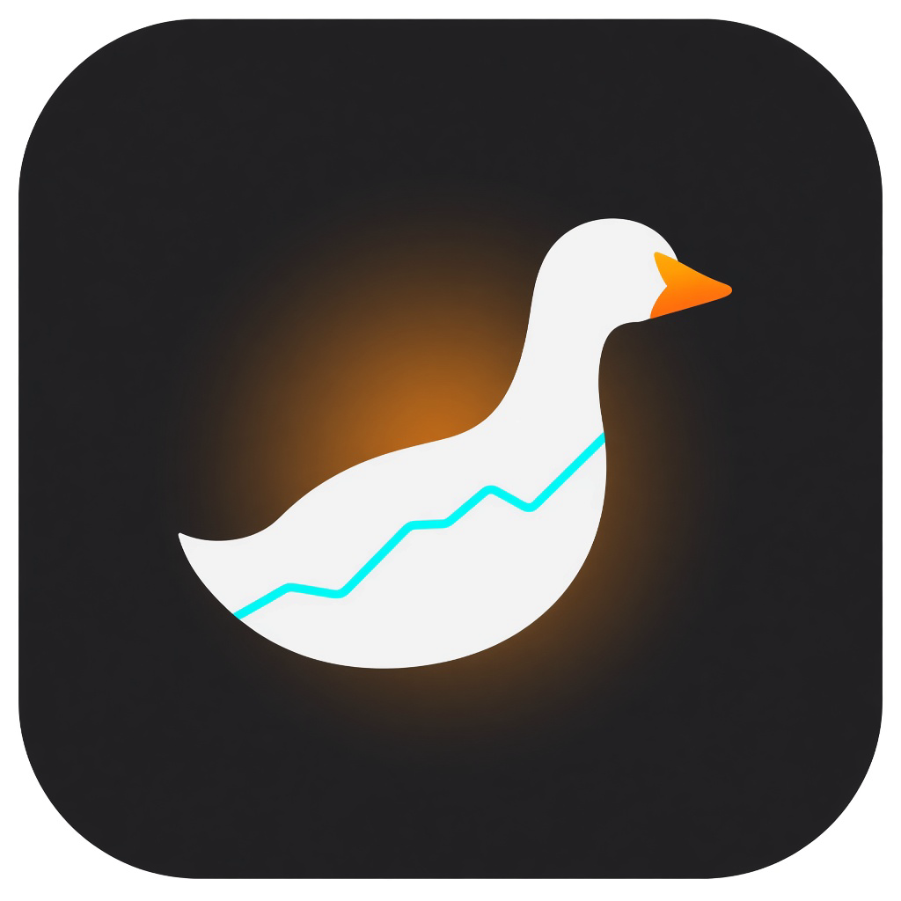
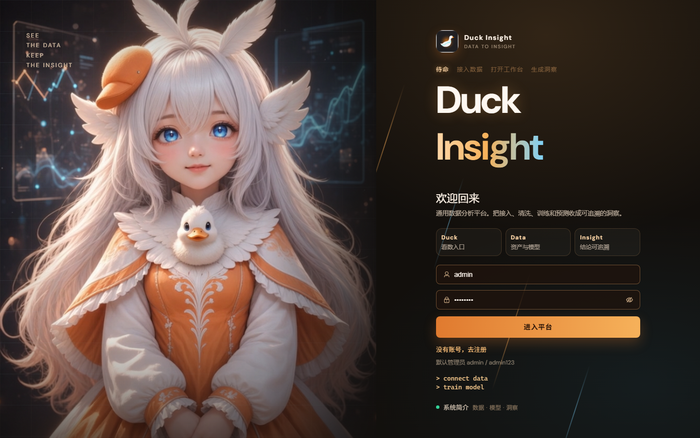
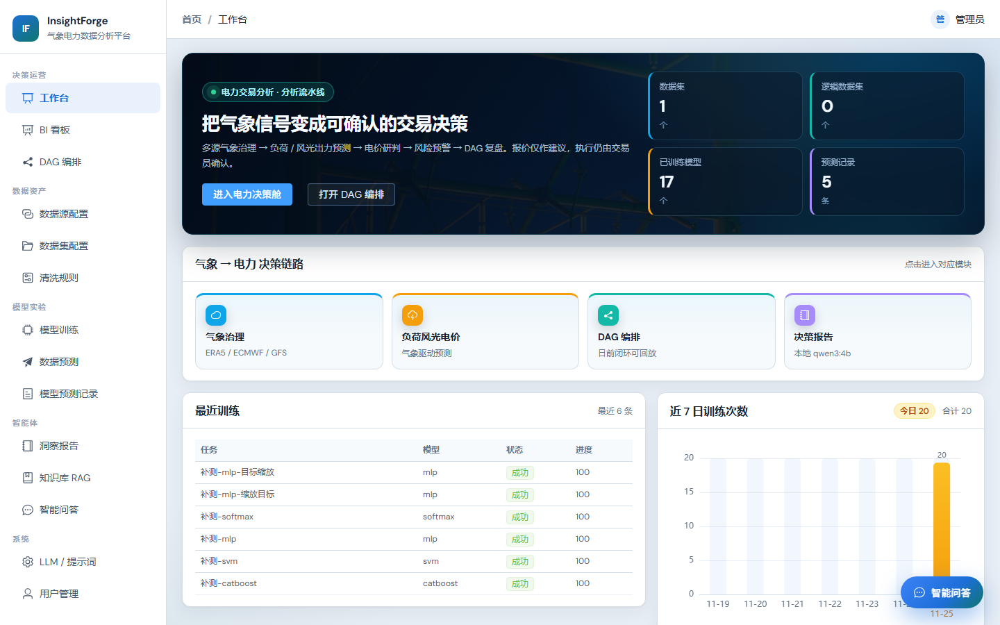
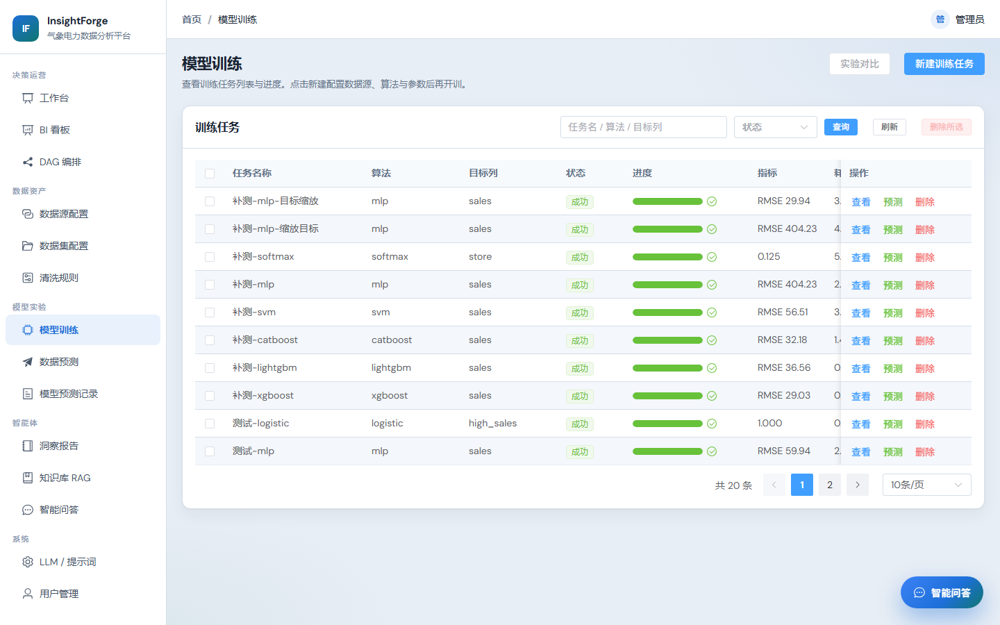
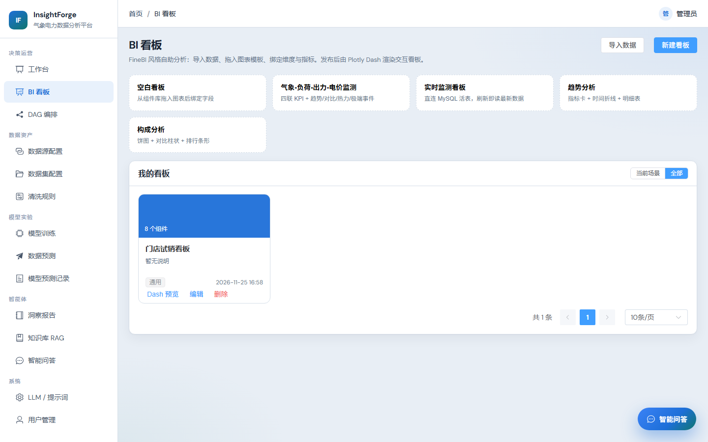

<p align="center">
  
</p>

<h1 align="center">Duck Insight</h1>

<p align="center">
  把表接进来，洗干净，训模型，再写成能回溯的洞察。<br/>
  一个网页端的数据分析平台。没有 MySQL 时，直接用 SQLite。
</p>

<p align="center">
  
</p>

<p align="center">
  <sub>打开就是登录页。左侧循环播放角色和数据画面，右侧进入平台。默认管理员 <code>admin</code> / <code>admin123</code>。</sub>
</p>

后端是 Flask，界面是 Vue 3。数据集、清洗规则、训练任务、预测记录和洞察报告都记在数据库里。模型可以接 DeepSeek，也可以接本机 Ollama。

## 看一眼

登录后先到工作台。上面是数据集、逻辑数据集、已训练模型和预测记录，下面是最近的训练和近 7 日次数。

<p align="center">
  
</p>

<p align="center">
  <sub>这张图来自 SQLite 上的一轮门店销量测试。当天训了 20 次，列表里能看到 MLP、Softmax、SVM 和 CatBoost。</sub>
</p>

训练页按任务查看算法、目标列、进度和指标。训完可以直接去预测，也可以删掉这次任务。

<p align="center">
  
</p>

看板从数据表生成。可以放指标卡、趋势、对比和构成，也可以从空白看板自己摆。

<p align="center">
  
</p>

## 能做什么

- **接入数据。** 上传 CSV、TXT、Excel，或登记一个 MySQL 数据源再导入表。字段类型和角色会先推断出来，可以再改。
- **洗数据。** 清洗规则是一组可复用的步骤：去重、拆日期、补缺失、类别编码、标准化。绑定到数据集后留下快照，训练和预测都走同一套规则。
- **训模型。** 线性回归、岭回归、Lasso、逻辑回归、Softmax、SVM、多层感知机、决策树、随机森林、GBDT、XGBoost、LightGBM、CatBoost。文本列可以再试 BERT。训练记录指标和特征重要性。
- **做预测。** 按原始列手填一行，或下载模板回传。日期拆分、编码和缩放在预测时套用训练时保存的清洗状态。
- **看结果。** 工作台汇总数量和近 7 日训练次数。BI 看板按日期出趋势，按类别出对比和构成。
- **写洞察。** 选一个已训练的模型和一个大模型，按评估指标和特征重要性生成报告。普通数据集用通用分析口吻；场景名里带电力或气象时，才使用那套业务提示词。
- **问知识库。** 文档切块后做检索。问答和洞察都可以带上检索到的片段。
- **排流程。** DAG 把数据集、清洗、训练和后续步骤连在一起，可以手动跑，也可以定时跑。
- **账号。** 注册和登录之后，数据按用户分开。管理员可以管理用户。

## 快速开始

需要 Python 3.12 和 Node.js。本机如果有 Conda 环境 `data-analysis`，用它，里面已经带上 XGBoost、LightGBM 和 CatBoost。

```bash
conda activate data-analysis
cd backend
pip install -r requirements.txt
python app.py
```

另开一个终端：

```bash
cd frontend
npm install
npm run dev
```

浏览器打开 http://127.0.0.1:3001 。后端在 http://127.0.0.1:5000 。

不配置数据库时，启动会在 `storage/duck_insight.sqlite` 建库、建表，并写入默认管理员。这个文件、上传的数据和训练产物都不进仓库。

## Docker

服务器上只需要 Docker。在 `docker` 目录执行：

```bash
cp .env.example .env
docker compose up -d --build
```

浏览器打开 `http://服务器IP:8080`。容器里默认也是 SQLite，数据在卷 `duck-insight-data`。第一次构建会安装 PyTorch 和几个 Boosting 库，镜像比较大。

要用已有 MySQL，把 `.env` 里的 `DB_ENGINE` 改成 `mysql`，并填上主机、库名和账号。数据库在宿主机上时，`MYSQL_HOST` 填宿主机 IP。

## 数据库

| 变量 | 作用 |
| --- | --- |
| `DB_ENGINE` | 留空或 `sqlite` 时使用 SQLite。设为 `mysql` 时连接 MySQL |
| `MYSQL_HOST` | MySQL 地址。不填就继续用 SQLite |
| `MYSQL_PORT` | 默认 `3306` |
| `MYSQL_DATABASE` | 默认 `insight_forge` |
| `MYSQL_USER` / `MYSQL_PASSWORD` | MySQL 账号 |

本机也可以不设环境变量，把连接写在 `backend/db.local.json`。这个文件已在 `.gitignore` 里。

外部数据源仍然是 MySQL。平台自己的元数据库才会在 SQLite 和 MySQL 之间切换。

## 目录

```text
backend/     Flask、清洗、训练、预测、洞察和 RAG
frontend/    Vue 3 + Element Plus 界面
docker/      前端 Nginx 和后端两个容器
dataset/     随仓库附带的小时级样例表
db/          表结构
docs/        登录页、工作台、训练和看板的界面图
storage/     运行后的数据库、上传文件和模型，不进仓库
```

## 默认账号

`admin` / `admin123`。部署到别人能访问的机器上之后，先改掉这个密码。大模型的密钥写在「LLM / 提示词」里，保存在数据库中，不要把 `storage/` 提交上去。
